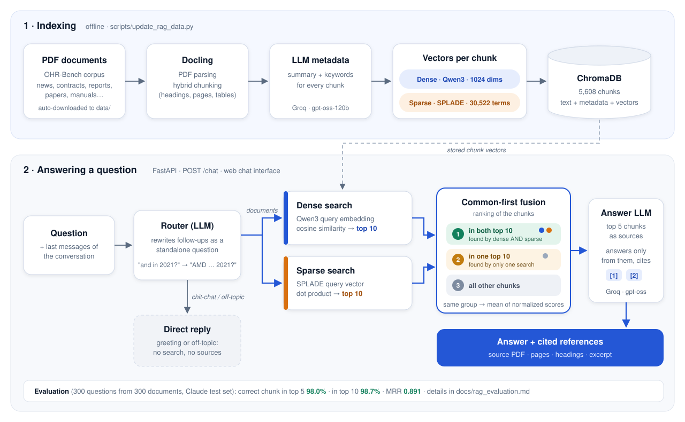

# RAG System

Question answering over a collection of PDF documents (the OHR-Bench corpus:
news, contracts, financial reports, manuals, scientific papers, administrative
documents).

- **Indexing:** PDFs are parsed with Docling, split into chunks, summarized by
  an LLM (Groq) and stored in Chroma with three vectors per chunk: a dense
  embedding (Qwen3-Embedding) and SPLADE sparse vectors of the text and of
  the summary.
- **Retrieval:** a dense (Qwen3) search and a sparse (SPLADE) search each
  return their top 10 chunks; chunks found by both are ranked first ("common
  first").
- **Answering:** a FastAPI service with a web chat interface. The LLM answers
  from the retrieved chunks and cites them; the references are returned with
  the answer.



## Project structure

```
ragsystem
├── README.md
├── pyproject.toml / uv.lock      # Dependencies (uv)
├── docs/                         # Documentation (data, test data, evaluation) + images/
├── scripts/
│   ├── update_rag_data.py        # Pipeline: download -> parse -> chunk -> embed -> Chroma
│   └── run.py                    # Shortcut for update_rag_data.py
├── src/
│   ├── ragsystem/
│   │   ├── api/                  # FastAPI service + web chat interface (static/index.html)
│   │   ├── core/
│   │   │   ├── rag_pipeline/     # Docling ingestion, chunker, vectorizer (dense + SPLADE)
│   │   │   ├── dense_sparse_retriever.py  # Retriever used by the API
│   │   │   └── retriever.py      # Older BM25 + vector retriever
│   │   ├── evaluation/           # Retrieval evaluation scripts
│   │   ├── prompts/              # LLM prompts (metadata, questions, chatbot)
│   │   └── utils/                # Parser, Groq connector, data downloader, test question generator
│   └── app/app.py                # Legacy Streamlit app (old retriever, see below)
├── test_data/                    # Evaluation questions (Groq and Claude sets)
├── results/                      # Evaluation results (JSON)
│
│   Not in git (generated or private):
├── data/                         # PDF corpus, downloaded automatically
├── chroma_db_v1/                 # Current Chroma index
└── secrets/config.yaml           # GROQ_API_KEY
```

## Documentation

- [Data](docs/data.md): what the corpus contains, and how it is downloaded,
  chunked, embedded and stored.
- [Test data](docs/test_data.md): how the retrieval test questions are
  generated, and their format.
- [Evaluation](docs/rag_evaluation.md): results of 26 retrieval methods
  on the Claude and Groq test sets.

## Setup

```bash
uv sync
```

Create `secrets/config.yaml`:

```yaml
GROQ_API_KEY: "your-key"
```

## Build the index

Run the scripts from the repository root:

```bash
uv run python scripts/update_rag_data.py --chroma-dir ./chroma_db_v1
```

Without `--chroma-dir`, the index is written to `./chroma_db`. The API reads
`./chroma_db_v1` by default (see `RAG_CHROMA_DIR` below).

If `data/` has no PDFs, the corpus is downloaded first (see
[docs/data.md](docs/data.md)). Files already in the collection are skipped.

Options:

| Option | Effect |
| --- | --- |
| `--limit N` | Process at most N new documents per run (default `MAX_DOCUMENTS` in the script, `0` = all) |
| `--categories academic law ...` | OHR-Bench categories to download (default: all except `textbook`) |
| `--skip-download` | Only index what is already in `data/` |
| `--force-download` | Download even if `data/` is not empty (adds missing files) |
| `--rebuild` | Drop the collection and re-index everything |

To only download the data: `uv run python -m ragsystem.utils.data_downloader`.

## Chatbot API

A REST API that answers questions from the documents and returns the
references it used. Retrieval method: `Common first: embedding + sparse`.

1. The dense search (Qwen3 embedding, cosine) and the sparse search (SPLADE,
   dot product) each take their own top 10 chunks.
2. Chunks found by **both** searches are ranked first, then chunks found by
   one search, then all the others.
3. Inside each group, chunks are ordered by the average of the two
   normalized scores. The top 5 are sent to the LLM as sources.

```bash
uv run uvicorn ragsystem.api.main:app --host 0.0.0.0 --port 8000
```

Startup takes about a minute (models and index are loaded once). Then open
<http://localhost:8000> for the chat interface, or
<http://localhost:8000/docs> for the raw API.

| Endpoint | Description |
| --- | --- |
| `GET /` | Chat interface: conversation history (left), answers with clickable citations, document groups and main topics (right). `/?q=your+question` asks a question directly |
| `POST /chat` | `{"question": "...", "top_k": 5}` → answer with citations `[1]`, `[2]`… and the matching references |
| `GET /documents` | Overview of the indexed documents: groups (news, contracts…) and main topics |
| `GET /health` | Status and number of indexed chunks |
| `GET /docs` | Interactive documentation |

```bash
curl -X POST http://localhost:8000/chat \
  -H "Content-Type: application/json" \
  -H "X-API-Key: <your key>" \
  -d '{"question": "How many pilgrims died during the hajj in Saudi Arabia?"}'
```

Each reference contains the number used in the answer, the chunk id, the
source PDF, title, pages, headings, retrieval score and an excerpt. Only the
sources cited in the answer are returned (none when the answer is not in the
documents).

**Conversation and off-topic messages.** Send the previous messages in
`history` so follow-ups work:

```json
{
  "question": "And how did it compare to the previous year?",
  "history": [
    {"role": "user", "content": "What were AMD's marketing expenses in 2022?"},
    {"role": "assistant", "content": "About $683 million in 2022 [1]."}
  ]
}
```

Before searching, one LLM call classifies the message (`intent` in the
response):

| `intent` | Example | Behaviour |
| --- | --- | --- |
| `documents` | "And how did it compare to the previous year?" | Rewritten as a standalone question (`search_query`), then searched and answered with citations |
| `chitchat` | "Hello", "What can you do?" | Short reply, no search |
| `off_topic` | "Write a poem", "Write Python code" | Refusal with example topics, no search |

The web interface sends the last 8 messages of the open conversation.

Configuration (environment variables):

| Variable | Default | Meaning |
| --- | --- | --- |
| `RAG_CHROMA_DIR` | `./chroma_db_v1` | Chroma folder |
| `RAG_COLLECTION` | `documents` | Collection name |
| `RAG_GROQ_CONFIG` | `./secrets/config.yaml` | File containing `GROQ_API_KEY` |
| `RAG_API_KEY` | not set | If set, `/chat` requires the `X-API-Key` header |

### Sharing the API with a tester

To give someone a public link to the API running on your machine, use a
Cloudflare quick tunnel (free, no account):

```bash
brew install cloudflared                      # once

# terminal 1: start the API, protected by a key
RAG_API_KEY=choose-a-secret uv run uvicorn ragsystem.api.main:app --port 8000

# terminal 2: open the tunnel
cloudflared tunnel --url http://localhost:8000
```

`cloudflared` prints a URL like `https://xxxx.trycloudflare.com`. Send the
tester that URL and the key:

- **Chat interface:** the URL itself. The API key field appears at the top
  right when a key is required.
- **Raw API:** the URL followed by `/docs`. They open `POST /chat`, click
  **Try it out**, fill in the `x-api-key` field and the question, then click
  **Execute**.

The link works only while your computer is on, awake and running both
commands, and it changes every time the tunnel restarts.

## Evaluation

```bash
# Generate a test set (Groq LLM, 300 questions)
uv run python -m ragsystem.utils.generate_test_questions

# Compare the 26 retrieval methods on a test set
uv run python -m ragsystem.evaluation.evaluate_combinations --test-file test_data/groq_test_questions.jsonl
```

Results are written to `results/` and reported in
[docs/rag_evaluation.md](docs/rag_evaluation.md).

## Legacy Streamlit app

`src/app/app.py`: first chat interface, using the older BM25 + vector
retriever and `./chroma_db`. It does not read the current index.
